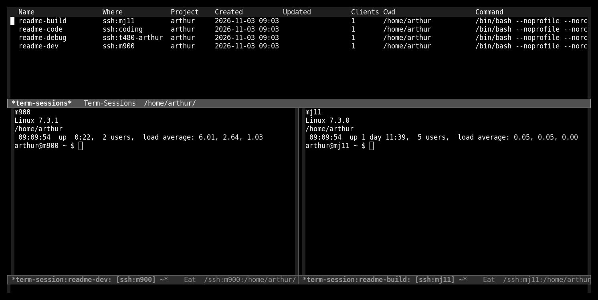
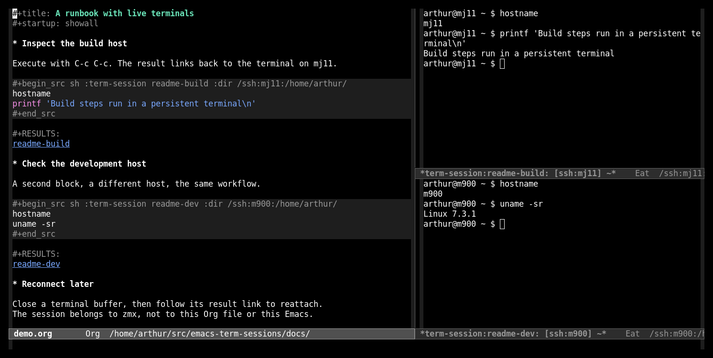

#+title: term-sessions.el

Named terminals that survive buffer kills, Emacs restarts, and SSH disconnects.
[[https://github.com/neurosnap/zmx][zmx]] owns the sessions; Emacs is just the client. Reopen the same session
from another Emacs—or another computer—without copying an Emacs-side database.

* Supported terminal frontends

=vterm=, =eat=, =ghostel=, =ebb=, and the built-in =term= and =shell=.
All support local and remote sessions through TRAMP.

* Get started

Install =zmx= on each session host, clone this repository, and evaluate:

#+begin_src emacs-lisp
(add-to-list 'load-path "/path/to/emacs-term-sessions")
(require 'term-sessions)
(setq term-sessions-preferred-frontend 'term) ; built in
#+end_src

For a Nix development environment with Emacs and zmx, run =nix develop=.

- =M-x term-sessions-open= — choose a session, or type a new name to create one.
- =M-x term-sessions-new= — create and attach to an unused numbered name, such as =term-1=.
- =M-x term-sessions-list= — browse sessions; =RET= attaches to the selected one.
- =M-x term-sessions-kill= — end a session, not just its Emacs buffer.

To work remotely, run these commands from a TRAMP directory such as
=/ssh:user@host:/path/to/project/=. The list also discovers already-open TRAMP connections.

* Run Org blocks in a persistent terminal

Execute a shell block with =C-c C-c=:

#+begin_src org
,#+begin_src sh :term-session build
hostname
printf 'Build steps run in a persistent terminal\n'
,#+end_src
#+end_src

The block opens the session if necessary, sends the code, and inserts a link
back to the live terminal. Output stays in the terminal; it is not captured as
Babel results. =:term-session t :session NAME= also works.

Use =M-x term-sessions-store-org-link= to save a session link in your notes.

* More

See the [[file:docs/reference.org][reference]] for frontend and TRAMP settings, Org links, command execution,
and the comparison with =detached.el=.

Licensed under [[file:LICENSE][GPL-3.0-or-later]].
